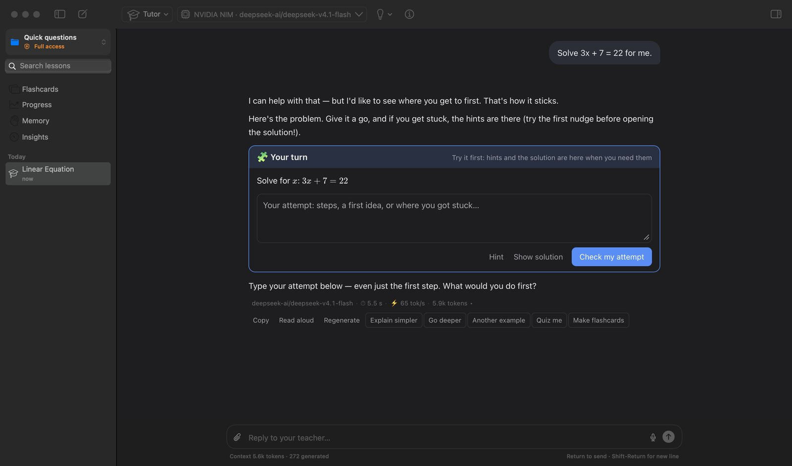
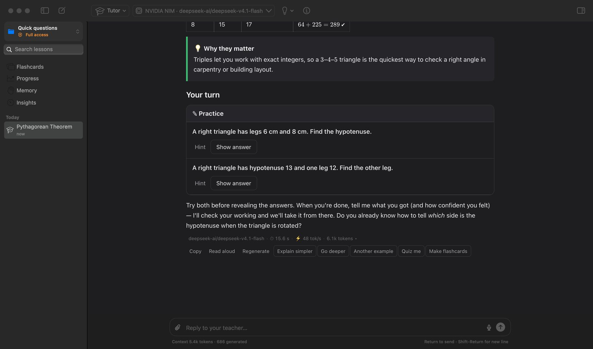
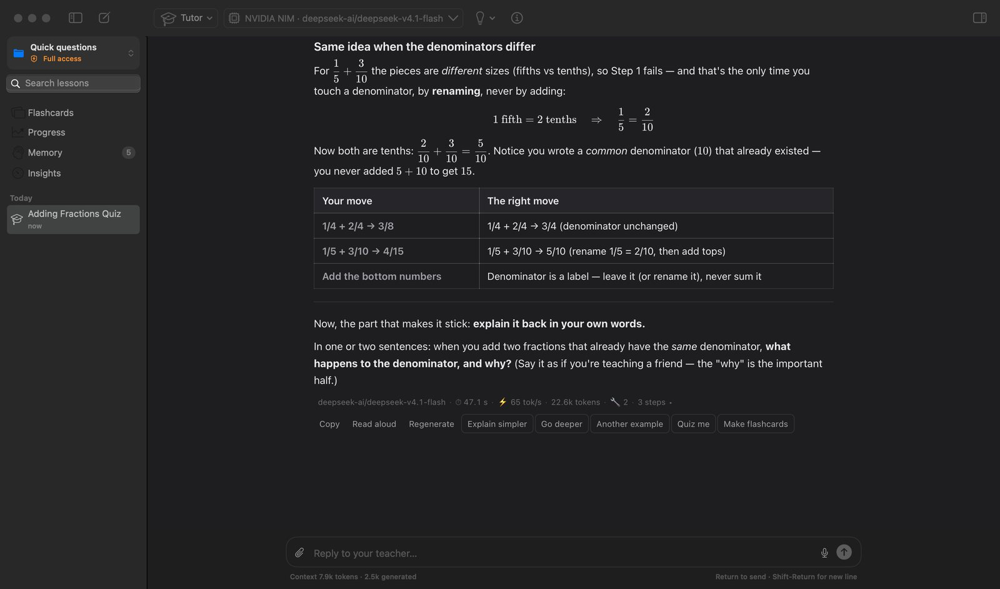
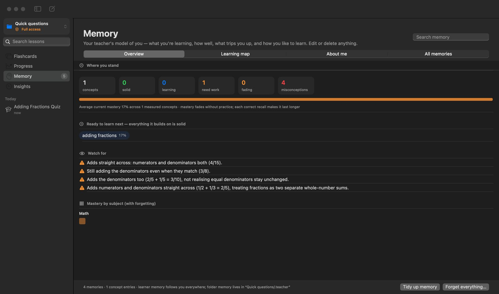
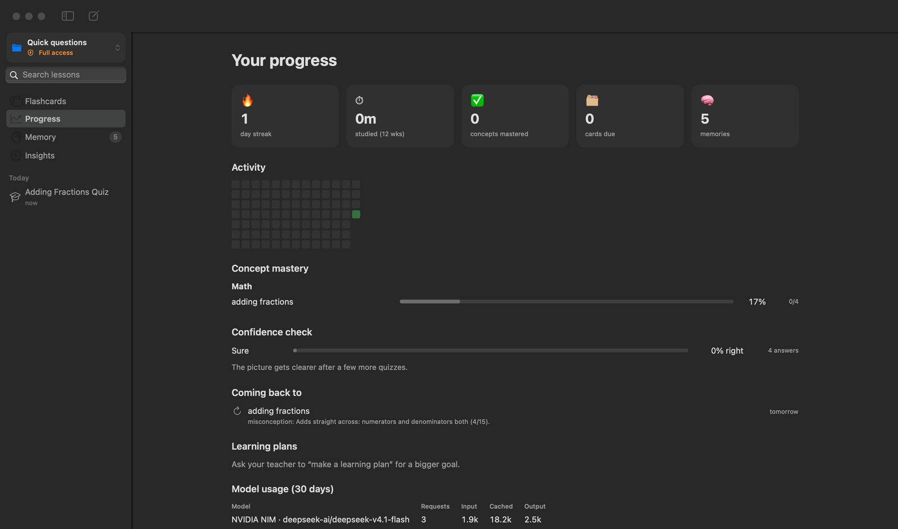

# My AI Teacher

A native macOS tutor that makes you do the thinking, plus a coding agent for your projects. It works with almost
any AI provider, free ones included, and keeps everything it learns about you on your Mac.



Built in Swift and SwiftUI with a single web view for the lesson transcript, and SQLite for state. It has no Electron,
no Node runtime and no third-party Swift packages. The app is about 21 MB and shows a lesson about a second after a
cold launch. It runs at roughly 70 MB plus one WebKit process (about 90 MB), a fraction of Electron-based AI apps.

## Install

1. Download **My-AI-Teacher-<version>.dmg** from [Releases](../../releases/latest). It needs macOS 14 or later on Apple Silicon.
2. Open the DMG and drag **My AI Teacher** into **Applications**.
3. The first time, right-click the app and choose **Open**, then **Open** again. The app is signed but not notarised by
   Apple, so macOS asks once. If macOS says it can't verify the app, go to **System Settings › Privacy & Security** and
   click **Open Anyway**, or run:

   ```bash
   xattr -dr com.apple.quarantine "/Applications/My AI Teacher.app"
   ```

## Get started

1. **Choose a model.** Open **Settings › Providers** (⌘,) and paste a key for any provider. Keys already exported in
   your shell (for example `ANTHROPIC_API_KEY` in `~/.zshrc`) are picked up automatically. No key yet? These cost nothing:
   * [OpenRouter](https://openrouter.ai) `:free` models, with a daily request limit;
   * [OpenCode Go](https://opencode.ai/docs/go/)'s `-free` models;
   * [NVIDIA NIM](https://build.nvidia.com)'s free tier;
   * a local model through [Ollama](https://ollama.com) or [LM Studio](https://lmstudio.ai).
2. **Start a lesson** with ⌘N and say what you want to learn: "Teach me the chain rule", "Quiz me on the French
   Revolution", "I have an exam on organic chemistry in two weeks". Pick a teaching mode from the toolbar.
3. **Ask a quick question** with ⇧⌘N. It isn't tied to a folder.
4. **Work on code** with ⇧⌘K. This opens a code session in a folder you choose.

The [user guide](docs/user-guide.md) covers everything in detail.

## What makes it different

### No toy lessons
Every mode follows one depth standard:
* examples and problems come from real practice (real systems, data, papers and failure modes), never "Alice has 3
  apples" or hello-world;
* teaching is pitched at the frontier of what you can do, and gets harder as you succeed;
* models plan, solve and verify with tools before they answer.

Reasoning effort defaults to high for lessons and sub-agents, and **Max** is available where the model supports it
(DeepSeek V4, Claude).
* **Context grows with the model.** Lessons keep up to half the model's window, at most 400k tokens, before trimming or
  summarising.
* **Plan and check.** A substantial request gets a hidden plan first. The plan lists what to verify with tools and what
  to research. A reviewer then reads the reply before you do; if it finds real problems, the reply is revised, and the
  draft stays collapsed in the transcript.

### Teaching that makes you think
AI tutors that hand out answers raise practice scores and lower exam scores ([Bastani et al., PNAS 2025](https://www.pnas.org/doi/10.1073/pnas.2422633122)).
Tutors that make students attempt and explain show large gains. So My AI Teacher is **attempt first** in every mode:

* **Problem cards.** Problems you bring, or that the teacher sets, come as cards. The teacher's hints and worked solution
  stay hidden until you try. Your attempt goes to the teacher, who gives one hint at a time, from a nudge to a full
  solution. If you're stuck for a while, the first hint opens by itself.
* **Quizzes with 14 question types**, graded instantly, including symbolic math checked with SymPy. Before seeing the
  result you mark how sure you were (Guessing, Unsure or Sure). A confident mistake gets extra attention.
* **Wrong answers name the misconception behind them.** The teacher explains it, gives you one near-identical retry,
  remembers it, and checks it again in a later lesson.
* **Mastery counts only what you do unaided.** Answers after a hint are logged but earn no credit. A fresh mastery is
  tested again a few days later, in a new context.
* **The teacher brings things back.** Due re-checks, forgotten flashcards and concepts that are fading come up in your
  next lesson without you asking.

### Lessons that show, not just tell
* Markdown with math (KaTeX, including chemistry) and highlighting for 190+ programming languages, Zig included.
* Mermaid diagrams, function plots, charts, timelines, comparison tables and vocabulary cards.
* Live interactive visuals: simulations in a sandbox, with three.js, d3, Chart.js and Matter.js available offline.
* Self-check practice cards, worked examples revealed step by step, and flashcards scheduled with FSRS.
* Read-aloud and dictation, and mixed-language lessons (for example English with Arabic or Japanese) with the right
  text direction, fonts, furigana and pinyin, plus click-to-hear pronunciation.

### A teacher that remembers you
A learner model rather than a chat log:
* subjects and concepts with prerequisites, and mastery that fades without practice;
* your goals, preferences and misconceptions;
* "ready to learn next", which lists what your solid knowledge unlocks.

You can see and edit all of it in **Memory**. **Progress** shows your activity, mastery, a confidence check (how often
you're right when you're sure) and what's coming back for review.

### A code mentor that builds with you
In **Code mentor** mode you learn programming — any language, framework, algorithm, data structure or system, from your
first program to research-level work — by understanding it and building with it.

* **Pitched at your level.** Before teaching, the mentor makes a hidden lesson design from what you've shown it: a
  first-time programmer gets one idea at a time and tiny programs to run; an expert gets the real implementation, the
  trade-offs and primary sources. Every example in the lesson has actually run on your Mac. A question gets an answer;
  a project comes when you want to build or practise.
* **A real project in your folder.** The mentor creates the starter files (structure, interfaces, TODOs, never the
  solution) and writes the tests to `.teacher/tests`, versioned with the project, sized to where you are.
* **Your own editor.** There is no built-in editor: use Helix, VS Code, Zed, Xcode, anything. The files are right there
  in the folder; save, then ask the mentor to check. `bash` runs the tests and the mentor reads your changes.
* **Tests that are proven.** When the mentor registers the project's test command, the app runs the tests on the
  starter. Any test runner works, in any language: red or green is the runner's exit code. A suite that already passes is
  refused as vacuous, and a red suite becomes the baseline for review.
* **The review.** Ask for a review and the app hands the mentor exactly what you changed since the last one (unified
  diffs), the test run, and the findings still open from the last round. The review comes back as a card: findings by
  file and line, `must` / `should` / `nit`, fixed ones struck through, the verdict. Like a demanding senior engineer:
  correctness and the failing tests first, then design, naming, edge cases, complexity, the tests you should add, with
  questions and hints rather than code. A pass with green tests records the project's concept as mastered.
* **The engineer's tools.** The mentor has `symbols`, `diagnostics`, syntax checks on its own files and the project
  profile, like the code agent, so it reads your code precisely and builds its examples against your real toolchain.
* **Languages and libraries from their source.** Ask to master Zig's standard library, Rust's `core`, Go's `net/http`,
  Python's `asyncio`, a package in your project, or any other language's installed sources, and the mentor teaches from the source installed on your Mac: it
  finds it by name (`source`), outlines it, reads the real implementation and cites file and line. The projects then
  reimplement a real piece of it against the original's behaviour.
* **Your files stay yours.** Once the tests are registered, the app refuses the mentor's edits to your files and to the
  locked tests, runs its commands inside a write fence the operating system enforces (so your own saves are never
  touched), and lets it start only read-only helpers. To change a test the mentor asks you to unlock them, and the
  change is recorded. It teaches with questions, a ladder of hints and the concepts so you find the fix. After a pass the
  folder opens for the next project.
* **Your Project panel.** Inspector → Project: the test history, failing tests (rerun one, ask for a hint), the open
  findings by file with hints you reveal one at a time and a link that opens the line in your editor, what you
  changed since the last review, and what the guard stopped. Run the tests or request a review yourself; a review
  starts with your own self-review. A pass after hints counts as evidence rather than unaided mastery, and the mentor
  asks you to explain one of your design choices; a few days later it brings back a small reimplementation to check
  it stuck. Export the project as a Markdown report, or restore your files to the last review.

### A language mentor
In **Language mentor** mode you learn a language the way the research says it sticks: comprehensible input one step
ahead of you, more output than input, immediate correction, and spaced retrieval of every word you meet.

* **It knows what you're learning.** The target language is detected as the lesson goes (what you asked for, which
  language the replies are tagged with) or set by the mentor after a quick placement, and every request carries the
  state: language, level, keyboard, words due.
* **An on-screen keyboard for the script.** Japanese (kana, or romaji typed as kana), Korean (jamo compose into
  syllables), Chinese pinyin with a tone-mark key, Arabic, Persian, Urdu, Hebrew, Russian, Ukrainian, Greek, Hindi,
  Bengali, Thai, and accent rows for Spanish, French, German, Portuguese, Vietnamese and twenty more. It appears under
  any quiz field and above the message box, so a test can ask for the real script.
* **Lessons that show the language.** Interlinear glosses with word roles and word-order lines to the translation,
  listening cards with slow playback and hidden text for dictation, role-play dialogues where your lines stay hidden
  until you've said them, conjugation tables that separate stem from ending, and Mandarin tone contours.
* **Tests that use your mouth and ears.** `speak` questions listen on-device in the target language and show which
  words were heard; dictation questions play first and grade strictly; accents can count.
* **Your vocabulary.** Words the mentor teaches (or you save from a vocabulary card) become flashcards in that
  language's deck, and the mentor opens each lesson with the ones that are due, used in new sentences. Progress shows
  each language's level and how many words are new, learning and known.
* **Language tools, offline.** Transliteration between scripts, word segmentation with parts of speech (Japanese and
  Chinese included), and Wiktionary definitions, so the mentor checks readings and forms before teaching them.

### A coding agent too
**Code sessions** work in a folder, much like Claude Code:
* read, edit and search files, and run commands, with your approval;
* a plan checklist, and project memory kept in `.teacher/code-memory.md`, `CLAUDE.md` or `AGENTS.md`;
* a git diff panel with checkpoints.

The agent can also:
* **Know the project before touching it.** Its prompt carries a profile read from the manifests: build system, how to
  build, check, test and lint it (`swift build`, `tsc --noEmit`, `cargo check`, `go vet`, `pytest`, make targets…),
  languages, git state. A `symbols` tool gives a file's outline or where a name is defined, so it reads the right
  twenty lines instead of the file.
* **Verify as it goes.** Every file it writes or edits is syntax-checked on the spot and the verdict rides on the tool
  result. `diagnostics` runs the project's check, tests or lint and returns the problems parsed (`file:line:col`),
  grouped and counted, instead of a build log. Long builds and test suites run in the background and report back.
* **Undo in one click.** Before the agent's first change to a file in a turn, the file is checkpointed; under the reply,
  **Undo this turn's changes** puts every file back, with or without git. Edits that differ only in indentation are
  matched and re-indented instead of failing.
* **Your own commands.** `.teacher/commands/review.md` becomes `/review`, with `$ARGUMENTS` filled in, like Claude
  Code's slash commands.
* **Delegate to sub-agents** (explore, coder, reviewer, tester, or your own definitions in `.teacher/agents/`). Each can
  have its own model, effort level and token or time budget. They run in the background, you can steer them, and they
  can work in git worktrees.
* **Drive an in-app browser**, to read pages, fill in forms and take screenshots.
* **Use Mac apps**, through the Accessibility tree and screenshots, with a permission gate for each app.

### Any model
Anthropic, OpenAI, Google Gemini, DeepSeek (V4 Flash and Pro), MiniMax, OpenRouter, NVIDIA NIM, Mistral, Groq, xAI,
Moonshot Kimi, Z.ai, Together, Cerebras, Fireworks, OpenCode Zen and Go, Ollama (cloud or local) and LM Studio. Any
OpenAI-, Anthropic- or Gemini-compatible endpoint can be added as a custom provider.
* Model lists come live from each provider, and the model picker searches loosely: "deepsek nvidia" finds NVIDIA's
  DeepSeek models.
* Thinking effort can be set per lesson.
* Prompts are cache-friendly, and each reply shows its model, time, tokens and speed.

## Screenshots

| A lesson | After a repeated mistake |
|---|---|
|  |  |
| **Memory: the teacher's model of you** | **Progress: mastery, confidence check, what's coming back** |
|  |  |

## Keyboard shortcuts

| | |
|---|---|
| ⌘N | New lesson |
| ⇧⌘N | Quick question (no folder) |
| ⇧⌘K | New code session |
| ⌘O | Open a folder |
| ⌥⌘1 / ⌥⌘2 / ⌥⌘3 | Flashcards / Progress / Memory |
| ⌘. | Stop the reply (Esc twice also stops an agent) |
| ⌘+ / ⌘− / ⌘0 | Text size |
| Space, then 1–4 | Show a flashcard's answer, then rate it |

## Your data stays on your Mac

* **What's stored where:**
  * your learner model, flashcards, mastery and plans: `~/Library/Application Support/MyAITeacher/teacher.sqlite`;
  * each folder's lessons: `<folder>/.teacher/`;
  * quick questions: `~/.teacher/no-dir-conversations/`.
* **API keys** you paste in are stored on this Mac, readable only by your user account.
* **Where messages go:** only to the provider you choose. Web search is keyless (DuckDuckGo and Bing). Lesson titles
  come from Apple's on-device model when it's available.
* **Telemetry:** the Insights dashboard is local only. Nothing is sent anywhere.
* **Permissions:** folders start read-only, and you grant *Read & write* or *Full access* for each one. Commands, writes
  outside what you granted, browser sites, Mac apps and fetches from your own Mac or local network all ask first.

## Build from source

You need macOS 14+ and the Xcode command-line tools (Swift 6). Optional extras: `python3` with `sympy` (math checking),
`rg` (faster search), and the toolchains of the languages you want `run_code` to run.

```bash
scripts/build-app.sh
```
```bash
open "build/My AI Teacher.app"
```

To make a release disk image:

```bash
scripts/make-dmg.sh
```

Tests, the live end-to-end harness and the profiler are described in [docs/development.md](docs/development.md).

## Documentation

* [User guide](docs/user-guide.md): every feature, setting and permission.
* [Development](docs/development.md): building, testing, the live harness, releases.
* [Architecture](ARCHITECTURE.md): design, invariants, extension points, bounded memory, runtime.
* [Memory design](docs/memory-design.md): how the learner model works and the evidence behind it.
* [Architecture review](docs/architecture-review.md): what the October 2026 review changed, per area, and what is left open.
