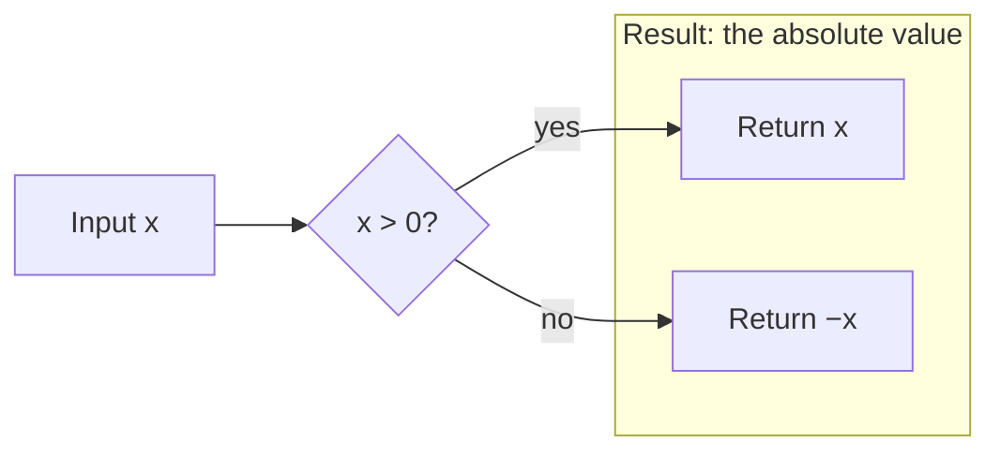
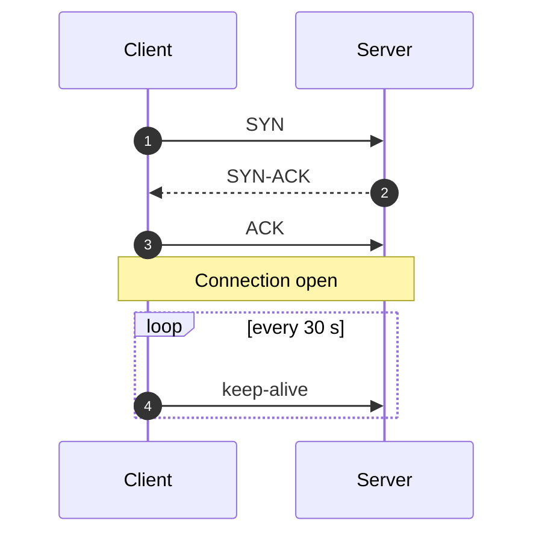
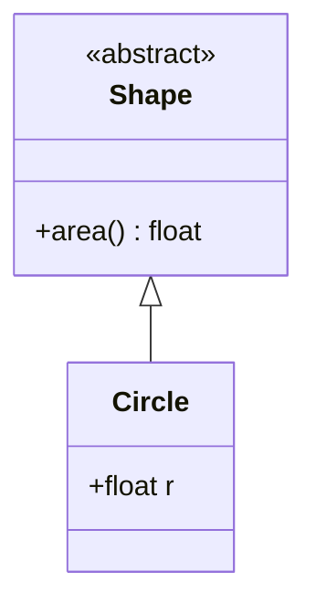
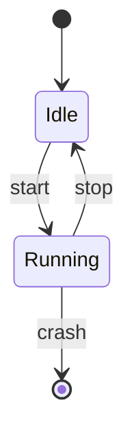
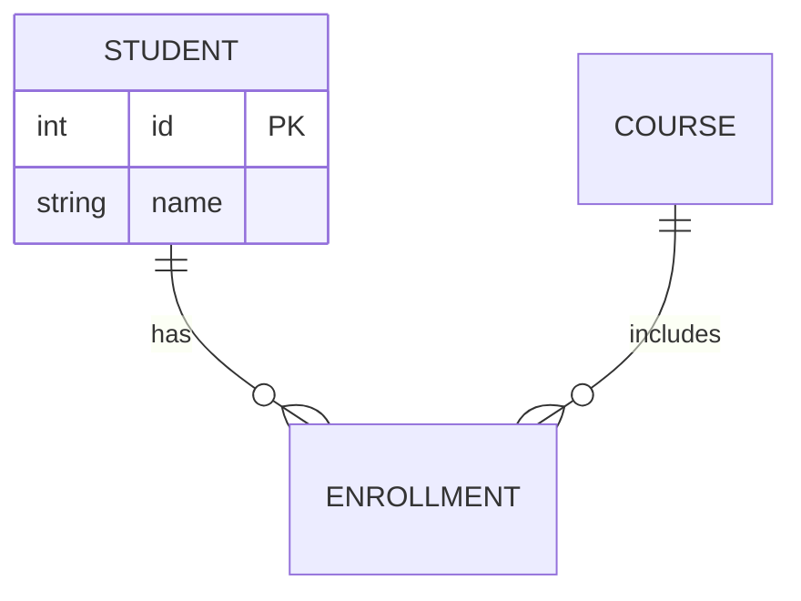
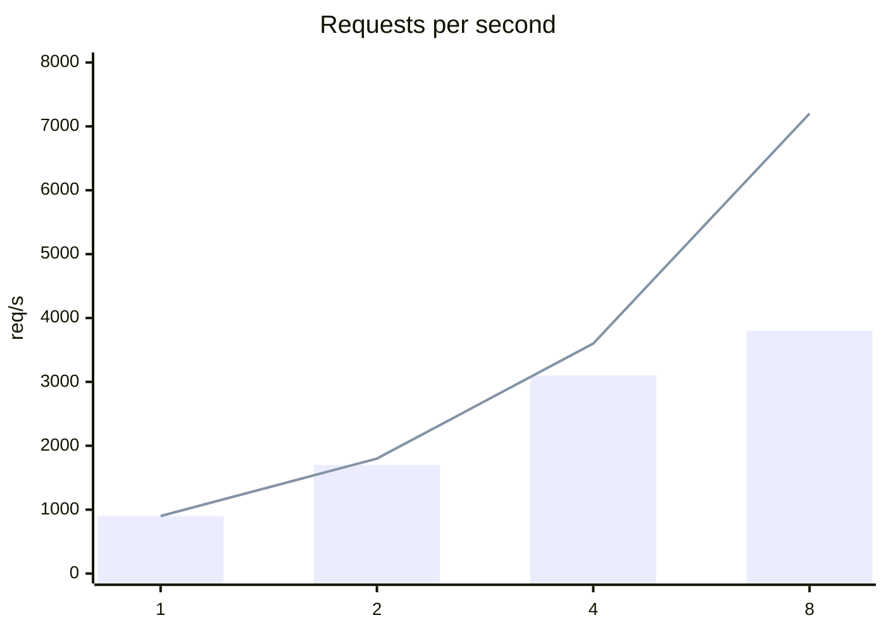
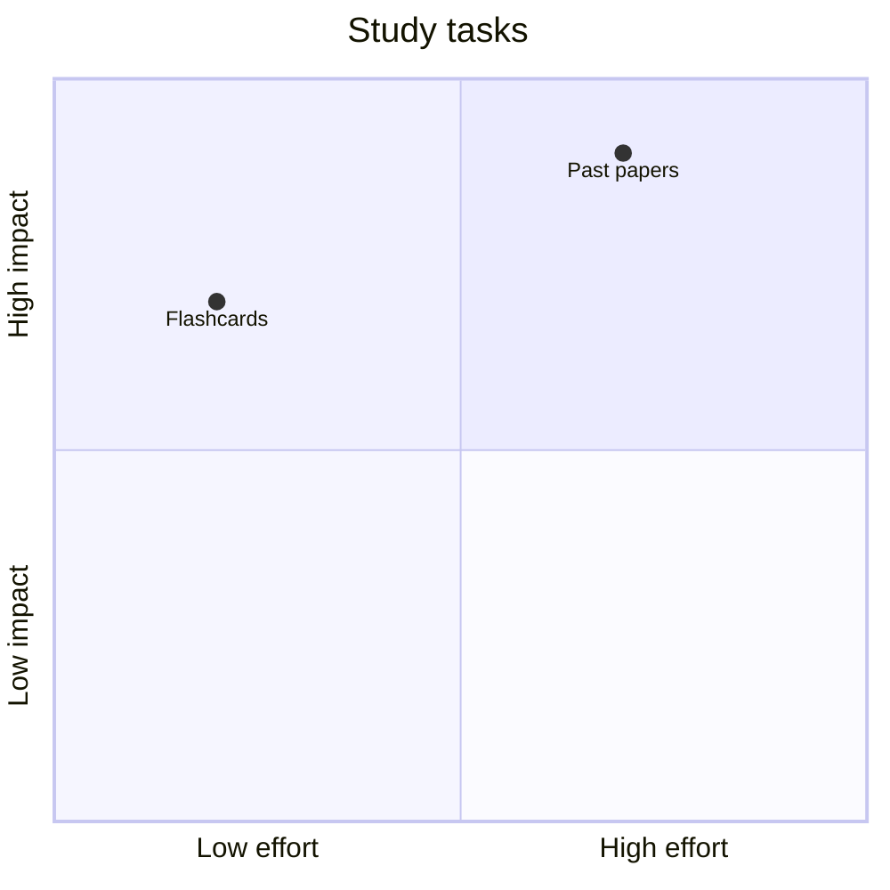
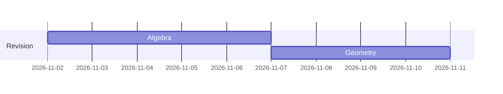
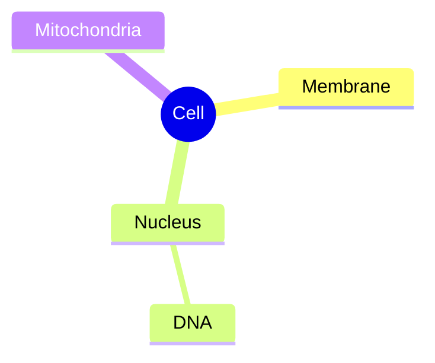

The first line names the diagram type. The app draws it in its own light and dark theme: don't set colours, themes or `%%{init}%%`.

| First line | For |
|---|---|
| `flowchart TD` or `LR` (also `graph`) | processes, decisions, architectures, pipelines |
| `sequenceDiagram` | messages between actors over time (protocols, APIs) |
| `classDiagram` | types, fields, inheritance, composition |
| `stateDiagram-v2` | state machines, lifecycles |
| `erDiagram` | tables and their relations |
| `gantt` | schedules and plans |
| `mindmap` | a topic's branches |
| `timeline` | periods and the events in them |
| `pie` | shares of a whole (few slices) |
| `quadrantChart` | two-axis comparisons (impact against effort) |
| `xychart` | quick bars and lines over categories |
| `sankey` | flows between stages (`source,target,value` rows) |
| `gitGraph` | commits, branches, merges |
| `journey` | steps scored by experience |
| `block`, `packet` | block layouts; the bit fields of a header |
| `architecture-beta` | services and their links |
| `radar-beta`, `treemap`, `kanban`, `requirementDiagram`, `C4Context`, `venn-beta`, `ishikawa` | as named |

Not available: zenuml, and `architecture` without `-beta`.

**Labels: the rule that breaks most diagrams.** Quote any label with brackets, parentheses, quotes, colons, ` `, `#` or `;`: `A["f(x) = x² (min)"]`, `A -->|"loss: halve"| B`, `subgraph g ["Group (1)"]`. Node ids are plain words (`step1`, not `step 1`); `end` is reserved (write `End`).

Shapes: `[box]` `(rounded)` `([stadium])` `[[subroutine]]` `[(database)]` `((circle))` `{decision}` `{{hexagon}}` `[/parallelogram/]`. Edges: `-->`, `---`, `-.->` dotted, `==>` thick, `--o`, `--x`, `<-->`; `A --> B & C` fans out.

Arrows: `->>` call, `-->>` reply, `-x` lost, `-)` async. Also `activate`/`deactivate`, `alt … else … end`, `opt … end`, `par … and … end`.

**Limits:** about 7 nodes per rank and 25 in all stay readable; split a bigger idea into two diagrams. Break long labels with ` ` inside quotes. A diagram that doesn't parse shows the learner the error and its source, and the error reaches you with their next message.
